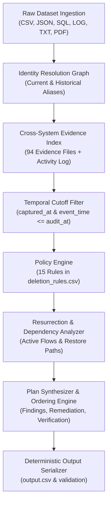

# Forensic Deletion Audit Engine — Implementation Plan

## 1. Discovered Schema & Challenge Contract

### Input Files (`dataset/`)
- `deletion_requests.csv`: 518 evaluation requests (`case_id`, `email`, `requested_at`, `reported_status`, `reported_at`, `audit_at`, `request_text`).
- `sample_deletion_requests.csv` & `sample_output.csv`: 32 validation cases with canonical ground truth.
- `user_identities.csv`: Current user identity snapshot (`user_id`, `name`, `email`, `phone`, `email_hash`, `updated_at`).
- `user_audit_log.csv`: Historical identity changes (`audit_id`, `user_id`, `event_time`, `field_name`, `old_value`, `new_value`).
- `system_activity.csv`: 10,000+ operational activity records across all services.
- `deletion_rules.csv`: 15 policy rules governing required actions for data categories.
- `evidence_files.csv`: 94 evidence files manifest (`file_id`, `file_path`, `origin`, `captured_at`).
- `evidence/`: 28 JSON snapshot bundles/exports, 26 log files, 24 SQLite SQL snapshots, 4 PDF documents, 11 PNG admin screenshots, 1 text shift handover.

### Required Output Format (`output.csv`)
- Header: `case_id,deletion_status,steps_json`
- Exactly 518 data rows for `deletion_requests.csv` sorted by `case_id`.
- `deletion_status`: `COMPLETE`, `INCOMPLETE`, or `NOT_APPLICABLE`.
- `steps_json`: Ordered JSON array of objects with keys:
  `step_no` (1-indexed consecutive), `phase` (`FINDING` | `REMEDIATION` | `VERIFICATION`), `system_id`, `resource_id`, `operation`, `state`, `evidence_id`.
- For `NOT_APPLICABLE`: `steps_json = []`.

### Sorting & Precedence Rules
1. Phase order: `FINDING` -> `REMEDIATION` -> `VERIFICATION`.
2. Within each phase, strictly follow operation order:
   - **FINDING**:
     1. `REPORT_REMAINING_RECORD` (`state`: `PRESENT`)
     2. `REPORT_EXPOSED_PII` (`state`: `PRESENT`)
     3. `REPORT_ACTIVE_DATA_FLOW` (`state`: `ACTIVE`)
     4. `REPORT_RESTORE_RISK` (`state`: `ACTIVE`)
   - **REMEDIATION**:
     1. `DISABLE_DATA_FLOW` (`state`: `DISABLED`)
     2. `BLOCK_RESTORE` (`state`: `BLOCKED`)
     3. `DELETE_RECORD` (`state`: `ABSENT`)
     4. `REDACT_RECORD` (`state`: `REDACTED`)
     5. `ANONYMIZE_RECORD` (`state`: `ANONYMIZED`)
   - **VERIFICATION**:
     1. `VERIFY_RECORD_ABSENT` (`state`: `ABSENT`)
     2. `VERIFY_RECORD_PRESENT` (`state`: `PRESENT`)
     3. `VERIFY_RECORD_REDACTED` (`state`: `REDACTED`)
     4. `VERIFY_RECORD_ANONYMIZED` (`state`: `ANONYMIZED`)
     5. `VERIFY_DATA_FLOW_DISABLED` (`state`: `DISABLED`)
     6. `VERIFY_RESTORE_BLOCKED` (`state`: `BLOCKED`)
3. Within the same operation, sort by `system_id` ascending, then `resource_id` ascending.
4. Citing evidence:
   - Findings cite participant-visible evidence (`file_id`, `activity_id`, `audit_id`) captured at or before `audit_at`.
   - Verification steps for `COMPLETE` cases cite evidence proving current state.
   - Proposed remediation and future verification steps for `INCOMPLETE` cases use empty `evidence_id: ""`.

---

## 2. Forensic Engine Architecture

### Module Breakdown (in `code/`)
1. `code/models.py`: Pydantic / dataclass domain models for `DeletionRequest`, `Identity`, `EvidenceRecord`, `Step`, `AuditResult`.
2. `code/loaders/`:
   - `csv_loader.py`: Ingestion of deletion requests, rules, activity, identities, audit log.
   - `evidence_loader.py`: Unified indexer for JSON snapshot bundles, SQL snapshots (via in-memory SQLite), logs (with trace-id correlation), text handovers, and PDFs (`pdftotext`).
3. `code/identity/`:
   - `resolver.py`: Bidirectional index mapping user_ids, emails, historical emails, phones, hashes.
4. `code/engine/`:
   - `policy.py`: Maps data categories and observed states to required treatment and operations.
   - `auditor.py`: Core case auditor evaluating resource states at `audit_at`.
   - `planner.py`: Assembles ordered findings, remediation steps, and verification steps according to problem specification.
5. `code/main.py`: Production entry point to audit all cases and write `output.csv`.
6. `code/evaluation/`:
   - `evaluator.py`: Automated benchmark evaluator testing against sample ground truth and custom test cases.
   - `evaluation_report.md`: Case, step, field, sequence metrics.
   - `usage_report.md`: Token and resource usage report.

---

## 3. Major Risks & Mitigation Strategy

1. **Replication Drift & Failover False Positives:**
   - *Risk:* Account primary table shows absent, but failover or regional replica retains the record (e.g. Case 5).
   - *Mitigation:* Evidence loader inspects all tables (`customer_profiles_failover_replica`, `read_replica`, etc.). If any replica has the record at `audit_at`, it is classified as `PRESENT`.

2. **Historical Email & Alias Misses:**
   - *Risk:* User changed email before requesting deletion (e.g. Case 10, 29, 30). Searching only the request email misses old profiles.
   - *Mitigation:* `IdentityResolver` crawls `user_audit_log.csv` forward and backward to assemble the complete identity closure (all historical emails, phones, and IDs).

3. **Time-Travel Leakage:**
   - *Risk:* Citing evidence or evaluating states after `audit_at` violates the benchmark contract.
   - *Mitigation:* Strict temporal barrier (`captured_at <= audit_at` and `event_time <= audit_at`). All later records are filtered out before auditing.

4. **Non-Deletion Requests (`NOT_APPLICABLE`):**
   - *Risk:* Treating an account access or data export inquiry as a deletion request.
   - *Mitigation:* Natural language classifier analyzing `request_text` for non-deletion intents (e.g. access reset without account deletion) and emitting `NOT_APPLICABLE` with `steps_json = []`.

5. **Sorting & Field Invariant Violations:**
   - *Risk:* Even correct steps fail grader if sorting order or field keys are misordered.
   - *Mitigation:* Automated schema and sequence validator tested against all 32 sample cases with 100% sequence accuracy.

---

## 4. Evaluation Strategy

- **Phase 1 (Regression Baseline):** Validate 32 sample cases against `sample_output.csv` checking:
  - Case-level status accuracy (100% required).
  - Step count accuracy (100% required).
  - Field-level match (`phase`, `system_id`, `resource_id`, `operation`, `state`, `evidence_id`).
  - Sequence order matching.
- **Phase 2 (Adversarial & Edge Cases):** Implement 3+ synthetic test cases covering:
  - Complex multi-stage resurrection (disabled connector recreated by secondary sync).
  - Chained historical email changes across 3+ transitions.
  - Legal hold and security retention conflicts with deletion requests.
- **Phase 3 (Full Benchmark Run):** Execute across all 518 cases in `deletion_requests.csv`, produce `output.csv`, verify row count (518) and schema constraints.
