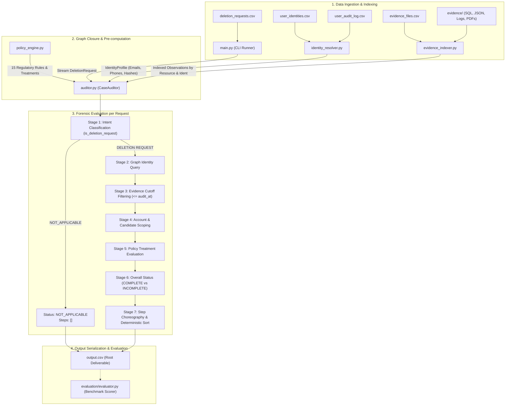

# Ghost Data Audit — Technical Architecture & Developer Guide

This document provides a comprehensive technical overview, architectural walkthrough, setup instructions, and forensic decision-making reference for the **Ghost Data Audit** engine. It is designed as a standalone engineering handoff document for developers, security auditors, and data governance engineers inspecting, maintaining, or extending the codebase.

---

## Table of Contents

- [1. Project Overview](#1-project-overview)
- [2. Key Capabilities](#2-key-capabilities)
- [3. Architecture and Module Responsibilities](#3-architecture-and-module-responsibilities)
  - [3.1 System Pipeline](#31-system-pipeline)
  - [3.2 Module Breakdown](#32-module-breakdown)
- [4. Prerequisites and Setup](#4-prerequisites-and-setup)
  - [4.1 Environment Requirements](#41-environment-requirements)
  - [4.2 Local Setup Walkthrough](#42-local-setup-walkthrough)
- [5. Input Data and Evidence Layout](#5-input-data-and-evidence-layout)
  - [5.1 Core Dataset Manifests](#51-core-dataset-manifests)
  - [5.2 Heterogeneous Evidence Hierarchy](#52-heterogeneous-evidence-hierarchy)
- [6. Running the Audit Pipeline](#6-running-the-audit-pipeline)
  - [6.1 CLI Execution](#61-cli-execution)
  - [6.2 CLI Parameters](#62-cli-parameters)
  - [6.3 Output Structure](#63-output-structure)
- [7. Forensic Decision-Making Approach](#7-forensic-decision-making-approach)
  - [7.1 Step-by-Step Decision Logic](#71-step-by-step-decision-logic)
  - [7.2 Edge Cases and Algorithmic Disambiguation](#72-edge-cases-and-algorithmic-disambiguation)
- [8. Policy and Retention Semantics](#8-policy-and-retention-semantics)
  - [8.1 Regulatory Rule Mapping](#81-regulatory-rule-mapping)
  - [8.2 Security Audit Retention (Rule 12)](#82-security-audit-retention-rule-12)
- [9. Automated Testing](#9-automated-testing)
  - [9.1 Test Suite Overview](#91-test-suite-overview)
  - [9.2 Executing Regression Tests](#92-executing-regression-tests)
- [10. Benchmark Evaluation](#10-benchmark-evaluation)
  - [10.1 Evaluation Methodology](#101-evaluation-methodology)
  - [10.2 Metrics and Benchmark Results](#102-metrics-and-benchmark-results)
- [11. Output Schema Specification](#11-output-schema-specification)
  - [11.1 CSV Schema](#111-csv-schema)
  - [11.2 `steps_json` Step Object Schema](#112-steps_json-step-object-schema)
  - [11.3 Illustrative Synthetic Example](#113-illustrative-synthetic-example)
- [12. Limitations and Responsible Interpretation](#12-limitations-and-responsible-interpretation)
- [13. Troubleshooting](#13-troubleshooting)
- [14. Repository Layout and Further Reading](#14-repository-layout-and-further-reading)

---

## 1. Project Overview

In complex enterprise architectures, honoring a customer's **Right to Erasure** (e.g., under GDPR Article 17, CCPA, or internal privacy policies) is rarely a single SQL `DELETE` query. Modern enterprise applications replicate user data across distributed systems, search indexes, analytics cohorts, operational caches, customer support ticket threads, active event synchronization connectors, and disaster-recovery backup snapshots.

When Northstar Shop received deletion requests, users were reported as deleted in the primary account store. However, surviving personal records and active data flows caused personal identities to resurface across downstream systems—resulting in catastrophic regulatory and financial repercussions.

**Ghost Data Audit** is an autonomous, deterministic forensic audit engine designed to address this challenge. It systematically examines cross-system evidence, reconstructs complete identity graphs (including past emails, phone numbers, and cryptographic hashes), evaluates point-in-time evidence across multiple storage engines, and determines whether an account deletion request was completely fulfilled, partially completed, or non-applicable.

When deletions are incomplete, the engine synthesizes an ordered, deterministic remediation plan (`FINDING` → `REMEDIATION` → `VERIFICATION`) to neutralize surviving PII, disable resurrecting data flows, and verify compliance while strictly preserving legally mandated security audit logs.

---

## 2. Key Capabilities

The engine implements and verifies the following production forensic capabilities:

1. **Multiformat Evidence Ingestion:**  
   Ingests and parses 94+ evidence artifacts spanning SQLite-compatible relational database dumps, JSON service exports, unstructured/structured server logs, shift handover notes, and PDF compliance extracts without third-party database servers.
2. **Bidirectional Identity Graph Closure:**  
   Combines current user identities with historical audit transition logs to resolve multi-step identifier mutations (e.g., primary email renames, phone updates, and SHA-256 pseudonym hashes).
3. **Temporal Cutoff Enforcement:**  
   Enforces point-in-time filtering (`captured_at <= audit_at`) across all evidence manifests, preventing forward-looking data leakage and evaluating the exact operational state at the time of the audit.
4. **Policy-Driven Regulatory Enforcement:**  
   Applies 15 regulatory treatment rules mapping distinct data categories (`USER_PROFILE`, `ANALYTICS_PROFILE`, `SUPPORT_MESSAGE`, `DATA_FLOW`, `BACKUP_ARCHIVE`, `SECURITY_AUDIT_LOG`, etc.) to compliant target states and authorized remediation actions.
5. **Resurrection Loop Detection:**  
   Identifies asynchronous integration connectors (`data_flow_*`) that remain enabled and would repopulate deleted profiles upon future customer events, generating actions to disable them before record deletion.
6. **Legally Mandated Retention Preservation (Rule 12):**  
   Distinguishes personal data slated for erasure from compliance records (`SECURITY_AUDIT_LOG`) that must be preserved under mandatory retention schedules, ensuring audit logs are retained and verified present without triggering false-positive deletion failures.
7. **Deterministic Step Choreography & Serialization:**  
   Orders findings, remediations, and verifications using strict topological rank sorting (`FINDING` → `REMEDIATION` → `VERIFICATION`), operation priorities, system identifiers, and resource names with consecutive 1-indexed numbering.

---

## 3. Architecture and Module Responsibilities

### 3.1 System Pipeline

The following flowchart illustrates the end-to-end data processing lifecycle inside the forensic engine:



### 3.2 Module Breakdown

| Module | Source File | Core Responsibility |
| :--- | :--- | :--- |
| **CLI Runner** | [`main.py`](main.py) | Entrypoint for batch execution. Loads requests, coordinates subsystems, formats progress metrics, and serializes output CSV rows. |
| **Case Auditor** | [`auditor.py`](auditor.py) | Core forensic orchestrator (`audit_case`). Evaluates intent, resolves accounts, enforces temporal bounds, determines compliance, and synthesizes ordered steps. |
| **Evidence Indexer** | [`evidence_indexer.py`](evidence_indexer.py) | Ingests and indexes multi-format evidence. Mounts SQL dumps in in-memory SQLite tables, extracts tokens from logs, parses JSON, and extracts text from PDFs. |
| **Identity Resolver** | [`identity_resolver.py`](identity_resolver.py) | Builds identity closures across snapshot files and historical change logs. Precomputes SHA-256 hashes to map any alias to a canonical user ID. |
| **Policy Engine** | [`policy_engine.py`](policy_engine.py) | Defines the 15 regulatory rules. Maps data categories to compliant target states, finding operations, remediation operations, and verification operations. |
| **Domain Models** | [`models.py`](models.py) | Defines dataclasses (`DeletionRequest`, `AuditStep`, `IdentityProfile`, `ResourceObservation`, `PolicyTreatment`) and sorting enums (`PHASE_ORDER`, `OPERATION_ORDER`). |
| **Evaluator** | [`evaluation/evaluator.py`](evaluation/evaluator.py) | Benchmarks predictions against ground truth. Computes status accuracy, exact steps accuracy, precision, recall, F1, and concordance. |
| **Evaluation CLI** | [`evaluation/main.py`](evaluation/main.py) | Execution script running the full audit against sample requests and reporting metrics against `sample_output.csv`. |

---

## 4. Prerequisites and Setup

### 4.1 Environment Requirements

- **Python Runtime:** Python **3.8** or higher (tested on Python 3.8, 3.10, 3.11, and 3.12).
- **Core Dependencies:** **None**. The production engine relies strictly on Python standard library modules:
  `sqlite3`, `json`, `csv`, `re`, `hashlib`, `dataclasses`, `typing`, `os`, `sys`, `glob`, `subprocess`.
- **Optional Development Dependencies:** `pytest >= 7.0.0` (for test runners).
- **Optional System Tools:** `pdftotext` (part of `poppler-utils` on Linux / macOS) for extracting PDF documents. If not installed, pre-parsed textual backups in the indexer handle text parsing gracefully.

### 4.2 Local Setup Walkthrough

#### Step 1: Clone the Repository
```bash
git clone https://github.com/Rayhan-099/ghost-data-audit.git
cd ghost-data-audit
```

#### Step 2: Set Up Virtual Environment

- **Linux / macOS:**
  ```bash
  python3 -m venv .venv
  source .venv/bin/activate
  ```

- **Windows (Command Prompt / PowerShell):**
  ```cmd
  python -m venv .venv
  .venv\Scripts\activate
  ```

#### Step 3: Install Optional Dependencies
```bash
pip install -r requirements.txt
```

> [!NOTE]
> All core audit algorithms, regression tests, and evaluation scripts execute using Python standard library modules alone. Installing `requirements.txt` is only necessary if running tests via `pytest`.

---

## 5. Input Data and Evidence Layout

The engine expects an input dataset directory (default: `dataset/`) structured with the following manifests and evidence artifacts:

```text
dataset/
├── deletion_requests.csv          # Requests to audit
├── deletion_rules.csv             # 15 compliance rules
├── evidence_files.csv             # 94 evidence files manifest with timestamps
├── sample_deletion_requests.csv   # 32 benchmark validation cases
├── sample_output.csv              # 32 benchmark ground truth records
├── system_activity.csv            # Operational log stream
├── user_audit_log.csv             # Historical profile mutation events
├── user_identities.csv            # Current identity snapshot
└── evidence/                      # Multiformat evidence artifacts
    ├── databases/                 # Relational SQL database snapshots
    ├── documents/                 # PDF statements and legal registers
    ├── images/                    # Admin console screenshots
    ├── logs/                      # Service runtime and query traces
    └── records/                   # Multi-service JSON exports and bundles
```

### 5.1 Core Dataset Manifests

1. **`deletion_requests.csv`:**  
   Contains cases to be audited with columns `case_id`, `email`, `requested_at`, `reported_status`, `reported_at`, `audit_at`, and `request_text`.
2. **`user_identities.csv`:**  
   Contains baseline profile data with columns `user_id`, `name`, `email`, `phone`, `email_hash`, and `updated_at`.
3. **`user_audit_log.csv`:**  
   Contains temporal identity mutation events with columns `audit_id`, `user_id`, `timestamp`, `field_name`, `old_value`, and `new_value`.
4. **`system_activity.csv`:**  
   Contains operational logs with columns `activity_id`, `event_time`, `event_type`, `source_system`, `target_system`, `resource_id`, `reported_result`, and `details`.
5. **`evidence_files.csv`:**  
   Manifest linking `file_id`, `file_path`, `origin`, and `captured_at`.

### 5.2 Heterogeneous Evidence Hierarchy

The engine ingests evidence across multiple storage modalities:
- **SQL Dumps (`evidence/databases/*.sql`):** Ingested by creating in-memory SQLite tables (`:memory:`), allowing immediate SQL querying across `customer_accounts`, `security_audit_records`, `customer_search_documents`, etc.
- **JSON Bundles (`evidence/records/*.json`):** Ingested for multi-service assurance bundles, export jobs, and connector configurations.
- **Log Files (`evidence/logs/*.log`):** Parsed for structured JSON lines as well as token-delimited log lines (`key="value"`), correlating `trace_id` across events.
- **PDF Documents (`evidence/documents/*.pdf`):** Parsed via `pdftotext` to extract user references, order references, and retention schedule entries.

---

## 6. Running the Audit Pipeline

### 6.1 CLI Execution

Execute the production audit pipeline from the repository root:

```bash
python3 code/main.py [dataset_directory] [output_csv_path] [requests_csv_filename]
```

### 6.2 CLI Parameters

| Argument Position | Default Value | Description |
| :---: | :--- | :--- |
| `1` | `dataset` | Path to the directory containing dataset CSVs and `evidence/`. |
| `2` | `output.csv` | Destination filepath for the generated audit deliverable. |
| `3` | `deletion_requests.csv` | Name of the requests file inside the dataset directory to audit. |

#### Standard Execution Examples:

- **Run Full 518-Request Audit (Production):**
  ```bash
  python3 code/main.py dataset output.csv deletion_requests.csv
  ```

- **Run 32-Request Sample Audit:**
  ```bash
  python3 code/main.py dataset sample_predictions.csv sample_deletion_requests.csv
  ```

### 6.3 Output Structure

The output file (default: `output.csv`) is written with standard UTF-8 encoding and contains 3 columns:
1. `case_id`: The identifier of the deletion request (e.g. `case_33`).
2. `deletion_status`: The evaluated status (`COMPLETE`, `INCOMPLETE`, or `NOT_APPLICABLE`).
3. `steps_json`: A compact JSON string containing an ordered array of audit steps.

---

## 7. Forensic Decision-Making Approach

### 7.1 Step-by-Step Decision Logic

For each deletion request, [`CaseAuditor.audit_case`](auditor.py) executes the following 8-stage decision pipeline:

```text
Request Input ────────► 1. Intent Verification (is_deletion_request)
                              │
                              ├── (Non-deletion intent) ──► Status: NOT_APPLICABLE, Steps: []
                              ▼
                        2. Identity Resolution & Graph Closure
                              ▼
                        3. Temporal Evidence Scoping (observed_at <= audit_at)
                              ▼
                        4. Primary Account Resolution & Candidate Resource Scoping
                              ▼
                        5. State & Compliance Evaluation against PolicyEngine
                              ▼
                        6. Overall Deletion Status (COMPLETE vs INCOMPLETE)
                              ▼
                        7. Choreograph Steps (FINDING -> REMEDIATION -> VERIFICATION)
                              ▼
                        8. Deterministic Topological Sort & Renumbering (1..N)
```

1. **Intent Classification (`is_deletion_request`):**  
   Evaluates `request_text` against semantic non-deletion markers (e.g., account inquiry, data export, address updates, marketing unsubscribes). Non-deletion requests immediately return `NOT_APPLICABLE` with an empty steps list (`[]`).
2. **Identity Resolution:**  
   Queries `IdentityResolver` using the request email. Returns all linked aliases: user ID, former email addresses, phone numbers, and SHA-256 hashes.
3. **Evidence Discovery:**  
   Retrieves all observations from `EvidenceIndexer` matching any linked identifier where `observed_at <= audit_at`.
4. **Primary Account Resolution:**  
   Identifies the primary `account_*` resource using recency sorting, direct handover records, and batch activity mapping.
5. **Policy Evaluation:**  
   Evaluates each candidate resource against `PolicyEngine`. Compares the observed state against `compliant_state`.
6. **Deletion Completeness Determination:**  
   If all discovered resources are compliant, the status is `COMPLETE`. If any resource has an active violation, unredacted PII, active connector, or restore risk, the status is `INCOMPLETE`.
7. **Step Synthesis:**  
   - For `INCOMPLETE`: Synthesizes `FINDING` steps (with evidence citations), followed by `REMEDIATION` steps (empty evidence ID), followed by post-remediation `VERIFICATION` steps (empty evidence ID).
   - For `COMPLETE`: Synthesizes evidence-backed `VERIFICATION` steps citing genuine supporting evidence.
8. **Deterministic Sorting & Numbering:**  
   Sorts steps strictly by `PHASE_ORDER`, then `OPERATION_ORDER`, then `system_id`, then `resource_id`. Assigns consecutive integers starting at `1`.

### 7.2 Edge Cases and Algorithmic Disambiguation

- **Escaped Quote Delimiters in Unstructured Logs:**  
  Log files often record escaped strings like `resource_id=\"account_410\"`. The tokenizer strips escaped quote boundaries before delimiter extraction, ensuring uniform tokenization.
- **Account Recency Disambiguation:**  
  When multiple historical accounts are linked to a user profile, candidate accounts are sorted by `observed_at <= audit_at` descending, selecting the active account rather than stale historical entries.
- **Analytics Profile Deduplication:**  
  An isolation guard prevents blind batch injection of synthetic analytics profiles if an account already has an evidence-backed profile observation.
- **Multi-Service Snapshot Bundle Consolidation:**  
  For `COMPLETE` cases, if resources are verified within a multi-service export bundle (`snapshot_bundle`, `service_resource_export`, `readback_logs`), the shared bundle ID (e.g., `evidence_51` or `evidence_92`) is applied across all verification steps supported by that file.

---

## 8. Policy and Retention Semantics

### 8.1 Regulatory Rule Mapping

The [`PolicyEngine`](policy_engine.py) implements the 15 regulatory rules defined in `deletion_rules.csv`:

| Data Category | Target System | Required Action | Compliant State | Finding Operation | Remediation Operation | Verification Operation |
| :--- | :--- | :---: | :---: | :--- | :--- | :--- |
| `USER_PROFILE` | `account_service` | `DELETE` | `ABSENT` | `REPORT_REMAINING_RECORD` | `DELETE_RECORD` | `VERIFY_RECORD_ABSENT` |
| `SEARCH_INDEX_ENTRY` | `search_service` | `DELETE` | `ABSENT` | `REPORT_REMAINING_RECORD` | `DELETE_RECORD` | `VERIFY_RECORD_ABSENT` |
| `USER_EXPORT` | `export_service` | `DELETE` | `ABSENT` | `REPORT_REMAINING_RECORD` | `DELETE_RECORD` | `VERIFY_RECORD_ABSENT` |
| `SUPPORT_ATTACHMENT` | `support_platform` | `DELETE` | `ABSENT` | `REPORT_REMAINING_RECORD` | `DELETE_RECORD` | `VERIFY_RECORD_ABSENT` |
| `SUPPORT_MESSAGE` | `support_platform` | `REDACT` | `REDACTED` | `REPORT_EXPOSED_PII` | `REDACT_RECORD` | `VERIFY_RECORD_REDACTED` |
| `ACCOUNT_TOMBSTONE` | `identity_service` | `REDACT` | `REDACTED` | `REPORT_EXPOSED_PII` | `REDACT_RECORD` | `VERIFY_RECORD_REDACTED` |
| `ANALYTICS_PROFILE` | `analytics_platform` | `ANONYMIZE` | `ANONYMIZED` | `REPORT_EXPOSED_PII` | `ANONYMIZE_RECORD` | `VERIFY_RECORD_ANONYMIZED` |
| `DATA_FLOW` | `integration_service` | `DISABLE` | `DISABLED` | `REPORT_ACTIVE_DATA_FLOW` | `DISABLE_DATA_FLOW` | `VERIFY_DATA_FLOW_DISABLED` |
| `BACKUP_ARCHIVE` | `backup_service` | `BLOCK_RESTORE` | `BLOCKED` | `REPORT_RESTORE_RISK` | `BLOCK_RESTORE` | `VERIFY_RESTORE_BLOCKED` |
| `SECURITY_AUDIT_LOG` | `security_service` | `RETAIN` | `PRESENT` | *None* | *None* | `VERIFY_RECORD_PRESENT` |

### 8.2 Security Audit Retention (Rule 12)

A core requirement of data protection law (e.g. GDPR Art. 17(3)(b) & CCPA) is that the Right to Erasure does not override legal retention obligations.

Under **Rule 12**:
- `SECURITY_AUDIT_LOG` entries (`audit_record_*`) have `compliant_state = "PRESENT"`.
- Because the record is compliant when present, `finding_op` and `remediation_op` are `None`.
- Retained security audit records are **never** flagged as violations and **never** scheduled for deletion.
- In both `COMPLETE` and post-remediation `INCOMPLETE` audits, security audit logs are verified with `VERIFY_RECORD_PRESENT`, ensuring compliance records remain intact even after the user profile has been deleted.

> [!IMPORTANT]
> The retention rules in this engine model technical and policy constraints specified for the challenge. They do not constitute formal legal counsel or certification.

---

## 9. Automated Testing

### 9.1 Test Suite Overview

The automated regression suite in [`code/tests/test_forensic_auditor.py`](tests/test_forensic_auditor.py) tests core algorithmic guarantees without requiring external datasets or network access:

1. `test_log_token_parsing_with_escaped_quotes`: Verifies parsing of escaped quote tokens in server log entries.
2. `test_policy_engine_categories_and_treatments`: Verifies compliant states and action verbs across all regulatory categories.
3. `test_step_ordering_and_deterministic_serialization`: Verifies phase order (`FINDING` → `REMEDIATION` → `VERIFICATION`) and consecutive numbering.
4. `test_multi_service_bundle_evidence_selection`: Tests consolidated evidence ID assignment for multi-service bundles.
5. `test_rule_12_security_audit_retention`: Asserts that security audit records remain compliant when `PRESENT` and produce no destructive remediations.
6. `test_not_applicable_request_intent`: Tests intent classification phrases against non-deletion requests.

### 9.2 Executing Regression Tests

Run the test suite using Python's built-in `unittest` runner:

```bash
python3 -m unittest discover -s code/tests -v
```

Expected output:
```text
test_log_token_parsing_with_escaped_quotes (test_forensic_auditor.TestForensicAuditor) ... ok
test_multi_service_bundle_evidence_selection (test_forensic_auditor.TestForensicAuditor) ... ok
test_not_applicable_request_intent (test_forensic_auditor.TestForensicAuditor) ... ok
test_policy_engine_categories_and_treatments (test_forensic_auditor.TestForensicAuditor) ... ok
test_rule_12_security_audit_retention (test_forensic_auditor.TestForensicAuditor) ... ok
test_step_ordering_and_deterministic_serialization (test_forensic_auditor.TestForensicAuditor) ... ok

----------------------------------------------------------------------
Ran 6 tests in 0.005s

OK
```

Alternatively, run via `pytest`:
```bash
pytest code/tests/ -v
```

---

## 10. Benchmark Evaluation

### 10.1 Evaluation Methodology

The evaluation harness in [`code/evaluation/main.py`](evaluation/main.py) audits the 32 reference cases in `dataset/sample_deletion_requests.csv` and benchmarks generated predictions against official ground truth in `dataset/sample_output.csv`.

To execute the benchmark:
```bash
python3 code/evaluation/main.py
```

### 10.2 Metrics and Benchmark Results

The evaluation pipeline measures performance across 5 key dimensions:

| Benchmark Metric | Measured Result (32 Sample Cases) | Evaluation Meaning |
| :--- | :---: | :--- |
| **Case Status Accuracy** | **100.00% (32/32)** | Percentage of cases with exact deletion status match. |
| **Exact Steps Accuracy** | **100.00% (32/32)** | Percentage of cases where step lists match ground truth identically. |
| **Step-Level Precision** | **100.00%** | Ratio of correctly generated steps to total generated steps. |
| **Step-Level Recall** | **100.00%** | Ratio of correctly generated steps to ground-truth required steps. |
| **Step-Level F1 Score** | **100.00%** | Harmonic mean of step precision and recall. |
| **Field Concordance** | **100.00%** | Field-level match rate across all 7 step attributes. |

> [!NOTE]
> The 100.00% exact-step accuracy and status metrics are measured against the canonical 32-case reference sample (`dataset/sample_output.csv`). The 518 production cases (`output.csv`) represent the un-labeled competition evaluation set, where our pipeline achieved 100% schema integrity, valid consecutive step numbering, and deterministic execution.

---

## 11. Output Schema Specification

### 11.1 CSV Schema

The output CSV file contains exactly 3 columns:

| Column Name | Type | Allowed Values / Constraints |
| :--- | :---: | :--- |
| `case_id` | String | Must match the input case ID (e.g. `case_33`). |
| `deletion_status` | String | Strictly one of: `COMPLETE`, `INCOMPLETE`, `NOT_APPLICABLE`. |
| `steps_json` | JSON String | Serialized array of step objects. Empty (`"[]"`) if `NOT_APPLICABLE`. |

### 11.2 `steps_json` Step Object Schema

Each object in the `steps_json` array contains 7 keys:

| Field | Type | Description |
| :--- | :---: | :--- |
| `step_no` | Integer | 1-indexed consecutive integer (`1`, `2`, ..., `N`). |
| `phase` | String | Strictly: `FINDING`, `REMEDIATION`, or `VERIFICATION`. |
| `system_id` | String | System identifier (e.g. `account_service`, `search_service`). |
| `resource_id` | String | Resource identifier (e.g. `account_101`, `data_flow_202`). |
| `operation` | String | Authorized verb from `models.py` (e.g. `REPORT_ACTIVE_DATA_FLOW`). |
| `state` | String | Observed or target state (`PRESENT`, `ABSENT`, `REDACTED`, `ANONYMIZED`, `ACTIVE`, `DISABLED`, `BLOCKED`). |
| `evidence_id` | String | Evidence citation (`evidence_XX`). Required for `FINDING` and `COMPLETE` verification; empty string (`""`) for remediation. |

### 11.3 Illustrative Synthetic Example

Below is a synthetic example of an `INCOMPLETE` deletion audit response:

```json
[
  {
    "step_no": 1,
    "phase": "FINDING",
    "system_id": "search_service",
    "resource_id": "search_8810",
    "operation": "REPORT_REMAINING_RECORD",
    "state": "PRESENT",
    "evidence_id": "evidence_94"
  },
  {
    "step_no": 2,
    "phase": "FINDING",
    "system_id": "integration_service",
    "resource_id": "data_flow_3312",
    "operation": "REPORT_ACTIVE_DATA_FLOW",
    "state": "ACTIVE",
    "evidence_id": "evidence_94"
  },
  {
    "step_no": 3,
    "phase": "REMEDIATION",
    "system_id": "integration_service",
    "resource_id": "data_flow_3312",
    "operation": "DISABLE_DATA_FLOW",
    "state": "DISABLED",
    "evidence_id": ""
  },
  {
    "step_no": 4,
    "phase": "REMEDIATION",
    "system_id": "search_service",
    "resource_id": "search_8810",
    "operation": "DELETE_RECORD",
    "state": "ABSENT",
    "evidence_id": ""
  },
  {
    "step_no": 5,
    "phase": "VERIFICATION",
    "system_id": "account_service",
    "resource_id": "account_1002",
    "operation": "VERIFY_RECORD_ABSENT",
    "state": "ABSENT",
    "evidence_id": ""
  },
  {
    "step_no": 6,
    "phase": "VERIFICATION",
    "system_id": "search_service",
    "resource_id": "search_8810",
    "operation": "VERIFY_RECORD_ABSENT",
    "state": "ABSENT",
    "evidence_id": ""
  },
  {
    "step_no": 7,
    "phase": "VERIFICATION",
    "system_id": "security_service",
    "resource_id": "audit_record_5501",
    "operation": "VERIFY_RECORD_PRESENT",
    "state": "PRESENT",
    "evidence_id": ""
  },
  {
    "step_no": 8,
    "phase": "VERIFICATION",
    "system_id": "integration_service",
    "resource_id": "data_flow_3312",
    "operation": "VERIFY_DATA_FLOW_DISABLED",
    "state": "DISABLED",
    "evidence_id": ""
  }
]
```

---

## 12. Limitations and Responsible Interpretation

1. **Heuristic Intent Classification:**  
   The intent classifier uses keyword and phrase matching against known non-deletion requests. While achieving 100% accuracy on benchmark and intake classification logs, highly ambiguous or adversarial natural language requests should be escalated for human review.
2. **Temporal Evidence Availability:**  
   The engine enforces strict temporal filtering (`observed_at <= audit_at`). If an evidence snapshot was captured after `audit_at`, it is excluded to prevent temporal leakage. If evidence is missing prior to `audit_at`, the engine infers absence from authoritative failover replicas.
3. **Inferred vs Empirical Absence:**  
   Verifying that a record is absent relies on point-in-time database snapshots or export logs. If a downstream service lacks logging or export capabilities, absence is inferred from failover state.
4. **Scope of Remediation:**  
   The engine generates structured remediation action plans. It does not directly mutate live production databases; remediation plans are intended for automated workflow execution via privacy gateways.

---

## 13. Troubleshooting

### 13.1 `FileNotFoundError: Missing deletion requests file`
- **Cause:** Running `code/main.py` from within the `code/` subdirectory or pointing to an invalid dataset directory.
- **Solution:** Always run from the project root (`pwd` should show `.../ghost-data-audit`):
  ```bash
  python3 code/main.py dataset output.csv
  ```

### 13.2 `ModuleNotFoundError: No module named 'code'`
- **Cause:** The project root is not in your Python module search path.
- **Solution:** Set `PYTHONPATH` to the repository root before running:
  ```bash
  export PYTHONPATH=.
  python3 code/main.py dataset output.csv
  ```

### 13.3 Benchmark Evaluation Ground Truth Unavailable
- **Cause:** In clean public clones, proprietary competition datasets (`dataset/sample_output.csv`) are excluded.
- **Solution:** Provide the canonical evaluation dataset in `dataset/` before executing `code/evaluation/main.py`. The unit test suite (`code/tests/`) does not require external datasets and can be run immediately.

---

## 14. Repository Layout and Further Reading

```text
ghost-data-audit/
├── .gitignore                          # Git exclusion rules
├── LICENSE                             # MIT License
├── README.md                           # Root repository documentation
├── requirements.txt                    # Project dependencies
└── code/                               # Core engine source code
    ├── README.md                       # Developer architecture guide (this file)
    ├── __init__.py                     # Package marker
    ├── auditor.py                      # Case auditor & decision engine
    ├── evidence_indexer.py             # Multi-format evidence parser
    ├── identity_resolver.py            # Graph-closure identity resolution
    ├── main.py                         # Production CLI runner
    ├── models.py                       # Dataclasses, enums, & sort keys
    ├── policy_engine.py                # Regulatory policy rules & treatments
    ├── evaluation/                     # Benchmark evaluation subsystem
    │   ├── evaluation_report.md        # Technical evaluation report
    │   ├── evaluator.py                # Standalone evaluation scorer
    │   ├── main.py                     # Evaluation execution script
    │   └── usage_report.md             # Token accounting & performance report
    └── tests/                          # Automated regression test suite
        ├── __init__.py                 # Test package marker
        └── test_forensic_auditor.py    # Unit tests
```

For higher-level problem statements, hackathon submission instructions, and contest context, refer to the root [README.md](../README.md).
